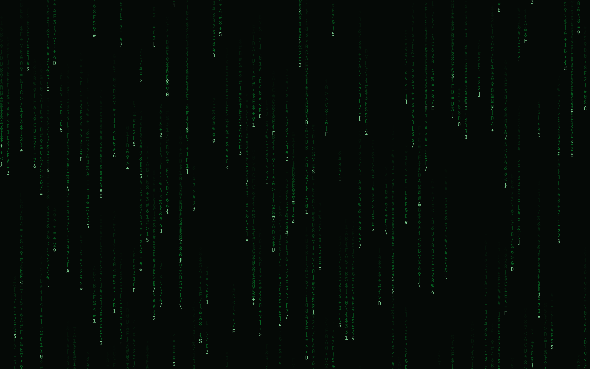

# hackibuntu

A neon green-on-black "hacker" look for Ubuntu's GNOME desktop. Same desktop, restyled.



Made on Ubuntu 26.04, GNOME Shell 50, Wayland, arm64. Other versions get a warning and may look different.

## Install

The repo is private, so the other computer needs an SSH key added to your GitHub account first.

```sh
sudo apt update
sudo apt install git zsh      # zsh is only needed for the terminal prompt
git clone git@github.com:abedinia/Hackibuntu.git
cd Hackibuntu
./install.sh                  # run as yourself, not with sudo
```

Open the terminal (Ptyxis) at least once before installing, so it has a profile to color.
Then **log out and back in**. For zsh as the default shell: `chsh -s /usr/bin/zsh`.

Use `./install.sh --no-shell` to leave your shell setup alone.

## What you get

- Matrix-style code-rain icons: hand-drawn glyphs for the apps in `tools/make-icons.py`, and for every other app its own icon turned green on the same tile (`tools/make-app-icons.py`). Folders and file types use Papirus-Dark with green folders. Run `./install.sh` again after installing new apps
- Dark olive/green GTK colors
- Floating bottom dock with green running dots
- Black and green top bar and menus (User Themes extension)
- Matrix code-rain wallpaper
- "Hacker" terminal palette, slightly see-through background, JetBrainsMono Nerd Font, in Ptyxis and in Terminator (if installed)
- zsh with Oh My Zsh, autosuggestions, syntax highlighting and a Starship prompt
- Launcher overrides for apps that name an icon file instead of an icon name (snaps, Zed and others)

Pinned dock apps are left as they are. Everything goes into your home folder.

The installer downloads icons from Ubuntu's archive, and fonts, Oh My Zsh, plugins and Starship from GitHub.

## Undo

```sh
./uninstall.sh
```

Your earlier settings and any replaced files are saved in `~/.local/share/hackibuntu/`.
